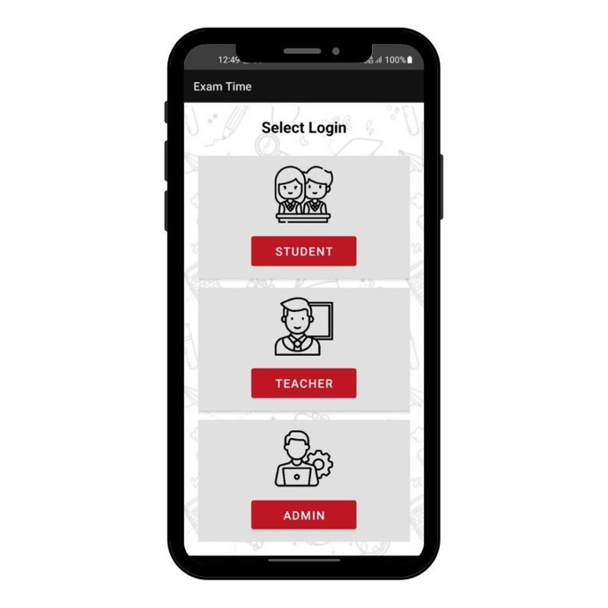

# 📚 Exam Cell Automation System

An Android application that streamlines examination management for educational institutions. The system provides dedicated portals for **Students, Faculty, and Admin** to manage attendance, examinations, results, notifications, and academic workflows through a single platform.

## ✨ Features

- 👨‍🎓 Student, Faculty & Admin Portals
- 🔐 Firebase Authentication
- 📅 Exam Scheduling & Notifications
- 📊 Attendance & Eligibility Management
- 📝 Result Management
- 📄 Question Paper Upload
- 🤖 AI-powered Question Paper Generation using ChatGPT API
- 💳 KT Form & Payment
- 📨 Leave Application

## 🛠️ Tech Stack

- **Java**
- **Android Studio**
- **Firebase Authentication**
- **Firebase Realtime Database**
- **MySQL**
- **OpenAI (ChatGPT API)**

## 📱 Screenshots

<table>
  <tr>
    <th>Profile</th>
    <th>Student Login</th>
    <th>Student Dashboard</th>
  </tr>
  <tr>
    <td></td>
    <td></td>
    <td></td>
  </tr>

  <tr>
    <th>Student Result</th>
    <th>KT Payment</th>
    <th>Teacher Dashboard</th>
  </tr>
  <tr>
    <td></td>
    <td></td>
    <td></td>
  </tr>

  <tr>
    <th colspan="3">Admin Dashboard</th>
  </tr>
  <tr>
    <td colspan="3" align="center">
      
    </td>
  </tr>
</table>
